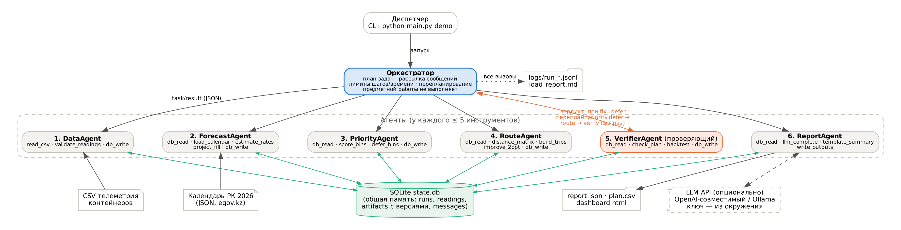
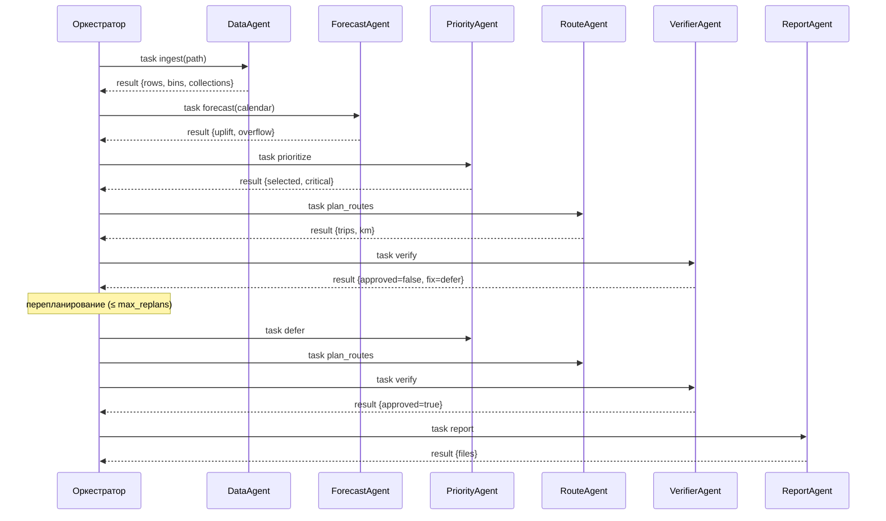

# Waste MAS: многоагентная система планирования вывоза ТБО (Астана)

Проект по курсу «Многоагентные ИИ-системы» (Ассайнмент 2, Ассайнмент 4, экзамен).
Тема связана с магистерской работой «Цифровая платформа для автоматизации сбора и вывоза мусора в г. Астана».

Система каждый день решает, **какие контейнеры вывозить завтра и каким маршрутом**.
Шесть агентов делят работу так: данные → прогноз → приоритеты → маршруты → независимая проверка → сводка.
Оркестратор только планирует и раздаёт задачи. Агент-проверяющий может отклонить план,
и тогда оркестратор запускает перепланирование, но не более 3 раз.

* Python 3.11+, **только стандартная библиотека**: sqlite3, urllib, json. Устанавливать ничего не нужно.
* Работает офлайн. LLM подключается по желанию, ключ берётся из переменных окружения.
* 18 тестовых сценариев с ожидаемым результатом (18/18 ✅) и 24 unit-теста.
* Лог JSONL фиксирует каждый вызов агента, инструмента и LLM. Отчёт о распределении нагрузки показывает максимум 21.7% вызовов на одного агента при лимите 40%.

## Быстрый старт

```bash
cd research/waste-mas
python main.py demo                          # типовой сценарий → results/
python main.py scenarios                     # 18 тестовых сценариев → results/scenarios/
python -m unittest discover -s tests -v      # unit- и интеграционные тесты
```

В Windows вместо `python` используется `py -3`. Открыть результат: `results/dashboard.html`.

Пример вывода `demo`:

```
[approved] План утверждён проверяющим агентом
Шагов: 6, перепланирований: 0, вызовов инструментов/LLM: 23, макс. доля агента: 21.7%
  data         3 вызовов   13.0%
  forecast     5 вызовов   21.7%
  priority     3 вызовов   13.0%
  report       3 вызовов   13.0%
  route        5 вызовов   21.7%
  verifier     4 вызовов   17.4%
Трасса: data.ingest → forecast.forecast → priority.prioritize → route.plan_routes → verifier.verify → report.report
```

## Команды

| Команда | Что делает |
|---|---|
| `python main.py demo` | Типовой сценарий на `data/astana_bins.csv` |
| `python main.py run --input my.csv --horizon 2 --threshold 75` | Свой CSV и параметры |
| `python main.py run --trucks 1 --trips-per-truck 1 --threshold 70` | Нехватка рейсов → перепланирование |
| `python main.py demo --llm` | Сводка диспетчеру через LLM (см. ниже) |
| `python main.py scenarios` | Все тестовые сценарии, отчёт `scenarios_report.md` |
| `python main.py generate --seed 7 --output data/other.csv` | Новый синтетический датасет |

Параметры: `--threshold` (порог, %), `--horizon` (дней), `--truck-capacity` (м³), `--trucks`, `--trips-per-truck`,
`--max-steps` (лимит шагов, по умолчанию 20), `--timeout` (с, 60), `--max-replans` (3), `--retries` (2).
Коды возврата: `0` — план утверждён, `1` — план отклонён или выполнение прервано лимитом, `2` — ошибка данных.

### Подключение LLM (необязательно)

```bash
cp .env.example .env        # .env в .gitignore, ключи в коде не хранятся
# локально через Ollama:   LLM_BASE_URL=http://localhost:11434/v1   LLM_MODEL=qwen2.5:7b
# или OpenAI-совместимый:  LLM_BASE_URL=https://api.openai.com/v1  LLM_MODEL=gpt-4o-mini  LLM_API_KEY=...
python main.py demo --llm
```

LLM пишет только текстовую сводку для диспетчера. Решения о вывозе и маршрутах принимают проверяемые алгоритмы.
Встроенная защита от галлюцинаций сверяет каждое число в ответе LLM с фактами плана. Если число не найдено,
ответ отклоняется и сводка строится по шаблону. Если LLM недоступна, делаются 2 повторные попытки, после них тоже используется шаблон.

## Архитектура



Схема взаимодействия: **оркестратор + общая память (blackboard в SQLite)**.
Оркестратор отправляет агенту сообщение `task` и получает обратно `result`. Оба сообщения — JSON-сериализуемые
dataclass `Message`; каждое пишется в лог и в таблицу `messages`. Промежуточные результаты
(прогнозы, решения, план, вердикт) агенты записывают в SQLite через инструменты `db_read`/`db_write`.
Каждая запись создаёт новую версию, поэтому при перепланировании виден весь путь, по которому менялся план.



### Таблица агентов

| # | Агент | Роль | Вход | Выход | Инструменты (≤ 5) | Критерий завершения |
|---|---|---|---|---|---|---|
| 0 | **Orchestrator** | Планирует задачи, рассылает сообщения, перепланирует, следит за лимитами | Конфигурация, сообщения `result` | Сообщения `task`, статус прогона | — (инструментов не вызывает) | Очередь задач пуста, или сработал лимит шагов/времени, или произошла ошибка |
| 1 | **DataAgent** | Загрузка и валидация телеметрии | `task ingest {path}` | `readings`, `dataset_summary` в SQLite | `read_csv`, `validate_readings`, `db_write` | Все строки проверены и сохранены, либо выдана ошибка с номером строки |
| 2 | **ForecastAgent** | Прогноз заполненности с учётом выходных и праздников | `readings`, календарь РК | `forecasts`, `forecast_model`, `calendar` | `db_read`, `load_calendar`, `estimate_rates`, `project_fill`, `db_write` | Есть прогноз для каждого контейнера на целевую дату |
| 3 | **PriorityAgent** | Отбор к вывозу и категории срочности; перенос контейнеров, если не хватает рейсов | `forecasts` / `decisions` | `decisions` (selected, category, reason) | `db_read`, `score_bins`, `defer_bins`, `db_write` | У каждого контейнера есть решение с объяснением |
| 4 | **RouteAgent** | Рейсы с учётом вместимости: ближайший сосед, затем 2-opt, затем распределение по машинам | `decisions`, `forecasts` | `plan` (trips, km) | `db_read`, `distance_matrix`, `build_trips`, `improve_2opt`, `db_write` | Каждый выбранный контейнер ровно в одном рейсе, рейс идёт депо → депо |
| 5 | **VerifierAgent** | Независимая проверка ограничений плана и бэктест прогноза | `decisions`, `plan`, `readings` | `verdict` (approved, violations, fix, MAE) | `db_read`, `check_plan`, `backtest`, `db_write` | Вынесен вердикт и составлен список нарушений |
| 6 | **ReportAgent** | Сводка для диспетчера и выходные файлы | Все артефакты | `report.json`, `plan.csv`, `dashboard.html` | `db_read`, `llm_complete`, `template_summary`, `write_outputs` | Файлы созданы |

Почему задачу решает команда агентов, а не один агент: у этапов разные данные, методы и критерии качества
(статистика, правила, комбинаторная оптимизация, генерация текста). Проверяющий агент
должен быть **независим** от того, кто строил план, иначе система проверяет сама себя.
Перепланирование — это настоящий диалог между агентами: проверяющий находит нарушение,
приоритизатор переносит наименее срочные контейнеры, маршрутизатор строит рейсы заново.

### Внешние инструменты и источники данных

1. **CSV-файл телеметрии** — `data/astana_bins.csv`: 60 контейнеров, 21 день, 1260 измерений.
2. **Производственный календарь РК 2026** — `data/kz_calendar_2026.json`: праздники и переносы по данным egov.kz.
3. **SQLite** — `results/state.db`: состояние задачи, версии артефактов, сообщения, история прогонов.
4. **LLM API** (опционально) — любой OpenAI-совместимый `/chat/completions`, в том числе локальная Ollama.
5. **Файловый вывод** — JSON, CSV и HTML.

### Надёжность и безопасность

| Требование | Реализация |
|---|---|
| Лимит шагов | `max_steps=20`; при превышении статус `aborted` (сценарий S12) |
| Лимит времени | `timeout_s=60`, проверка перед каждым шагом и вызовом инструмента (S13) |
| Защита от зацикливания | Не более `max_replans=3` перепланирований. Если перенос не дал прогресса или исправить нечего, система останавливается (S05) |
| Повторные попытки | 2 повтора с экспоненциальной паузой для сетевых и временных ошибок (S16). Ошибки данных не повторяются |
| Понятные сообщения | Без трассировки стека: «Строка 6: заполненность вне диапазона 0..100%» (S07) |
| Логирование | `results/logs/run_*.jsonl` — события `run_start`, `plan`, `message`, `agent_call`, `tool_call`, `llm_call`, `retry`, `guard`, `fallback`, `replan`, `run_end` |
| Ключи API | Только переменные окружения или `.env` (в `.gitignore`). В логах пишется лишь `api_key_set: true`, это проверяет отдельный тест |
| Защита CSV | Ячейки, начинающиеся с `= + - @`, экранируются |

## Модель данных и алгоритмы

* **Прогноз.** Для каждого контейнера по приростам внутри цикла накопления (между вывозами) оцениваются базовый темп
  `r` (п.п./рабочий день) и общий коэффициент роста в нерабочие дни `u` (медиана по контейнерам).
  Прогноз: `min(100, текущее + r · Σ(1 + u·[день нерабочий]))`. На демо-данных оценка `u = 0.36` при истинном значении 0.35.
* **Отбор.** К вывозу идут контейнеры с прогнозом ≥ порога или текущим заполнением ≥ порога.
  `critical` — ожидается переполнение (прогноз ≥ 100%) или контейнер уже заполнен на 95% и больше. Критические контейнеры никогда не переносятся.
* **Маршруты.** Ближайший сосед с ограничением вместимости, затем 2-opt внутри каждого рейса. Рейсы распределяются по машинам по кругу.
* **Проверка.** Каждый выбранный контейнер обслужен ровно 1 раз, нет лишних, вместимость не превышена,
  все критические на месте, рейсов не больше, чем доступно (`trucks × trips_per_truck`).
  Бэктест: последняя дата не используется при обучении, сравниваются наивный метод, линейный тренд и модель агента.

| Метод (контрольная дата 24.10.2026, n=53) | MAE, п.п. |
|---|---:|
| Наивный (завтра = сегодня) | 8.83 |
| Линейный тренд текущего цикла | 3.10 |
| **Модель ForecastAgent с календарём** | **0.69** |

## Тестовые сценарии

`python main.py scenarios` прогоняет [scenarios/scenarios.json](scenarios/scenarios.json): 18 сценариев,
у каждого заданы ожидаемый статус и проверяемые свойства. Последний результат лежит в [docs/scenarios_report.md](docs/scenarios_report.md).

| ID | Сценарий | Ожидаемый результат |
|---|---|---|
| S01 | Типовой сценарий | approved, без перепланирования, доля ≤ 40%, все критические обслужены |
| S02 | Горизонт 2 дня (перенос выходного 26.10) | approved, в прогнозе учтён 26.10, к вывозу ≥ 10 контейнеров |
| S03 | Качество прогноза | MAE модели < MAE тренда < MAE наивного метода |
| S04 | Нехватка рейсов | ≥ 1 перепланирования, часть контейнеров перенесена, критические обслужены |
| S05 | Невыполнимый план | rejected, `fleet_limit`, остановка без зацикливания |
| S06 | Контейнер больше машины | error с понятным текстом |
| S07–S11 | Битые данные (150%, нет файла, дубликат, заголовок, разные даты) | error с указанием причины |
| S12 | Лимит шагов | aborted |
| S13 | Лимит времени | aborted |
| S14 | LLM работает | сводка от LLM, 1 вызов LLM |
| S15 | LLM галлюцинирует | guard отклоняет ответ, сводка по шаблону |
| S16 | LLM недоступна | ≥ 2 повтора, сводка по шаблону, план утверждён |
| S17 | Другой датасет (seed=7) | approved, доля ≤ 40% |
| S18 | Порог 60% | approved, к вывозу ≥ 15 контейнеров |

## Отчёт и презентация

* [docs/report/Waste_MAS_Report_RU.pdf](docs/report/Waste_MAS_Report_RU.pdf) и [.docx](docs/report/Waste_MAS_Report_RU.docx): отчёт на 9 страниц.
* [docs/report/Waste_MAS_Presentation.pptx](docs/report/Waste_MAS_Presentation.pptx) и [.pdf](docs/report/Waste_MAS_Presentation.pdf): презентация из 9 слайдов.
* [docs/architecture.png](docs/architecture.png) — схема архитектуры (исходник: `architecture.dot`).

## Логи прогона

* [docs/logs/typical_run.jsonl](docs/logs/typical_run.jsonl) и [typical_load_report.md](docs/logs/typical_load_report.md) — типовой сценарий: 23 вызова, максимум 21.7%.
* [docs/logs/replan_run.jsonl](docs/logs/replan_run.jsonl) и [replan_load_report.md](docs/logs/replan_load_report.md) — с перепланированием: 35 вызовов, максимум 28.6%.
* [docs/logs/llm_run.jsonl](docs/logs/llm_run.jsonl) — прогон с вызовом LLM.
* [docs/example_dashboard.html](docs/example_dashboard.html) — пример панели диспетчера.

## Структура

```
waste-mas/
├── main.py                  # точка входа CLI
├── wastemas/
│   ├── core.py              # Config, Message, Reading, ошибки, загрузка .env
│   ├── runtime.py           # Logbook (JSONL), StateStore (SQLite), Runtime.call_tool (повторы, лимиты)
│   ├── tools.py             # инструменты агентов
│   ├── agents.py            # 6 агентов
│   ├── orchestrator.py      # план, рассылка, перепланирование, лимиты
│   ├── dashboard.py         # HTML-панель без внешних зависимостей
│   ├── datagen.py           # генератор синтетических данных
│   ├── scenarios.py         # прогон тестовых сценариев (+ заглушка LLM-сервера)
│   └── cli.py
├── data/                    # astana_bins.csv, kz_calendar_2026.json
├── scenarios/scenarios.json
├── tests/test_mas.py
└── docs/                    # схема, логи, отчёт, презентация
```

## Ограничения

* Данные **синтетические**: это вымышленные контейнеры с известной истинной моделью, а не измерения акимата.
  В «статус-кво» генератора контейнеры вывозятся по фиксированному графику: 3.3% контейнеро-дней приходятся на заполнение 100%,
  37% вывозов делаются при заполнении ниже 60%. Эти числа описывают только синтетический набор.
* Расстояния считаются по прямой (Haversine), без дорожного графа, пробок и временных окон.
* Жадный алгоритм + 2-opt не гарантирует оптимального решения задачи маршрутизации.
* Модель прогноза линейная, с одним общим коэффициентом нерабочих дней. Погода и сезонность не учитываются.
* Бэктест использует одну контрольную дату.

Лицензия: MIT.
